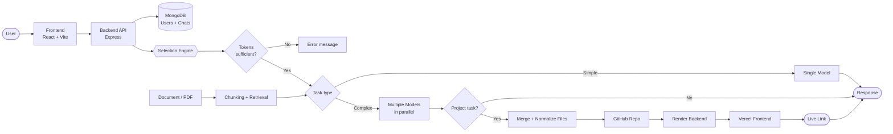

<div align="center">


# ⚡ ArixelAI

**Multi-model AI platform that plans, builds, repairs, and deploys full-stack apps from a single prompt.**

Intelligent model selection · Parallel multi-model execution · Self-healing builds · One-click live deployment

<p>
  <a href="https://jotishnitr.github.io/arixelAI/"><strong>🚀 Live Demo</strong></a>
  &nbsp;·&nbsp;
  <a href="#-key-features"><strong>Features</strong></a>
  &nbsp;·&nbsp;
  <a href="#-architecture"><strong>Architecture</strong></a>
  &nbsp;·&nbsp;
  <a href="#-getting-started"><strong>Get Started</strong></a>
</p>

<p>
  
  
  
  
  
  
</p>

</div>

---

## 📑 Table of Contents

- [Overview](#-overview)
- [What's New in 2.0](#-whats-new-in-20)
- [Key Features](#-key-features)
- [How a Full-Stack Build Works](#-how-a-full-stack-build-works)
- [Project Structure](#-project-structure)
- [Getting Started](#-getting-started)
- [Token & Rate-Limit Management](#-token--rate-limit-management)
- [Security](#-security)
- [License](#-license)

---

## 🌟 Overview

**ArixelAI** is a full-stack, multimodal AI platform powered by the custom **ArixelCore-1o** engine. It goes beyond chat: a **selection engine** routes every task to the best-suited model, **complex projects run in parallel across several models**, and the result is merged, packaged, pushed to GitHub, and **deployed live** with a public URL.

> [!TIP]
> Try it in your browser: **[jotishnitr.github.io/arixelAI](https://jotishnitr.github.io/arixelAI/)**

<div align="center">
  <!-- Replace with your screenshot: docs/images/app-screenshot.png -->
  
</div>

---

## 🆕 What's New in 2.0

| Upgrade | What it does |
| :--- | :--- |
| 🚀 **One-Click Live Deployment** | Frontend to Vercel, backend to Render, API URL wired automatically |
| 🛠️ **Self-Healing Build Loop** | Reads build logs, patches broken files, redeploys (up to 3 attempts) |
| 🐙 **GitHub Integration** | Creates a repo and pushes the full project in one atomic commit |
| 📦 **Project Zip Bundling** | Downloadable, ready-to-run full-stack archive |
| 🛡️ **Dependency Guardrails** | Auto-detects packages, fixes hallucinated names, stubs missing files |
| 📋 **Manual Deployment Guide** | Interactive step-by-step fallback when cloud limits block automation |
| 🧠 **Document RAG** | Semantic chunking and retrieval for PDF and document analysis |
| ⚡ **Token Optimizer + Usage Display** | Prompt compression, live usage, RPM/TPM/RPD/TPD control |
| 🎯 **Model Selection Engine** | Routes each task to the best available model |

---

## ✨ Key Features

### 🎯 Intelligent Model Selection Engine
- Analyzes each prompt and picks the best model for the task.
- Checks the user's remaining tokens before routing.
- Supports many model types: text, code, reasoning, image, and audio.
- Automatic **fallback chains** when a model is rate-limited or unavailable.

### 🤖 Multi-Model Parallel Execution
- Complex tasks (websites, apps, full-stack projects) split into components such as **Database Schema**, **Backend Logic**, and **Frontend UI**.
- Each component is generated in parallel by a dedicated model chain.
- Outputs are merged, deduplicated, normalized into a clean `client/` and `server/` layout, and bundled.
- Simple tasks run on a single model for speed.

### 🚀 One-Click Live Deployments
- **Frontend (Vercel):** bundles, configures, and deploys React/Vite apps to a public live URL.
- **Backend (Render):** provisions a Node/Express web service for full-stack apps.
- **Dual deployment mode:** deploys both and injects the backend URL into the frontend as `VITE_API_URL`.

### 🛠️ Autonomous Build-and-Repair Loop
- Captures live Vercel build logs and terminal errors on failure.
- A repair agent finds broken imports and syntax issues, patches the files, and re-triggers deployment.
- Up to **3 automated repair attempts** before falling back to the manual guide.

### 🐙 Automated GitHub Integration
- Connects through GitHub OAuth or a Personal Access Token.
- Creates a new repository on the user's account and pushes the whole codebase.
- Separates `client/` and `server/` cleanly and **excludes `.env` credentials**.

### 📦 Complete Project Bundling
- In-memory `.zip` generation straight from the chat message.
- Includes frontend components, backend routes, `package.json` files, and a generated `README.md` with run instructions.
- Injects standard Vite config, Tailwind/PostCSS setup, and `vercel.json` SPA routing so projects run out of the box.

### 🛡️ Dependency and Hallucination Guardrails
- Scans generated imports and builds a valid `package.json`.
- Corrects commonly hallucinated package names (for example `@lucide/react` → `lucide-react`).
- Stubs missing components and utility files to avoid build-breaking errors.

### 📋 Interactive Manual Deployment Guide
- If automation hits account limits (card verification, token scope), the UI shows a step-by-step manual guide instantly.
- Quick links to the generated GitHub repo and the Render/Vercel dashboards.
- **Copy Steps** button for easy follow-along.

### 🧠 Document Analysis (RAG)
- Semantic chunking and retrieval pipeline for PDFs and documents.
- Relevant excerpts are injected into the prompt instead of the full document, saving tokens.
- Scanned or image-based PDFs are handled through multimodal vision.

### ⚡ Token Optimizer and Usage Dashboard
- **Optimizer mode:** compressed, high-density responses to cut token consumption and speed up replies.
- **Live usage display:** per-prompt token estimate and daily usage meter.
- Per-model and per-provider usage persisted in the database.

### 💬 Chat Platform Essentials
- Persistent multi-turn context stored in MongoDB.
- Sidebar session manager with auto-generated chat titles.
- Image upload and analysis alongside text prompts.
- Markdown rendering with syntax-highlighted code blocks.
- Animated "thinking" UI with live generation and deployment status.

### 🔐 Authentication and Profiles
- Email/password (bcrypt, 10 salt rounds) and Google OAuth 2.0.
- JWT cookies with `SameSite=None; Secure=true` for cross-origin deployments.
- Route guards on all chat and profile endpoints.
- Editable user profile.

---

## 🏗️ Architecture

<div align="center">
  <!-- Replace with your architecture image: docs/images/architecture.png -->
  
</div>

### System Flow



---

## 🔄 How a Full-Stack Build Works

1. **Prompt:** the user describes the app.
2. **Select:** the engine checks tokens and chooses model chains per component.
3. **Generate:** components are built in parallel (database, backend, frontend).
4. **Merge:** files are extracted, normalized into `client/` and `server/`, and deduplicated.
5. **Harden:** dependencies are detected, hallucinated packages corrected, missing imports stubbed.
6. **Package:** a ready-to-run `.zip` is created with configs and a README.
7. **Ship:** repo is pushed to GitHub, backend deploys to Render, frontend deploys to Vercel.
8. **Heal:** if the build fails, logs go to a repair agent, files are patched, and deployment retries.
9. **Deliver:** the user gets a live URL and a downloadable archive.

---

## 🛠️ Tech Stack

| Layer | Technologies |
| :--- | :--- |
| **Frontend** | React 19, Vite 8, `react-markdown`, Custom CSS3 |
| **Backend** | Node.js, Express 5, Passport.js (`passport-google-oauth20`) |
| **Database** | MongoDB, Mongoose ODM |
| **AI Layer** | Multi-provider model routing, LangChain (document chunking), priority queue for rate limits |
| **Deployment** | Vercel REST API, Render API, GitHub REST API |
| **Packaging** | JSZip (in-memory archives) |
| **Security** | JWT, Bcrypt, Cookie-Parser, Express-Session, CORS |

---

## 📁 Project Structure

```
arixelAI/
├── client/                      # React 19 SPA (Vite)
│   ├── src/
│   │   ├── components/          # ChatArea, Sidebar, Modals, Deploy cards
│   │   ├── context/             # Auth and chat state
│   │   ├── styles/              # CSS and design tokens
│   │   └── App.jsx
│   └── package.json
│
├── server/                      # Express 5 REST API
│   ├── config/                  # DB and Passport setup
│   ├── controllers/             # Chat, auth, profile (chatResponse.js)
│   ├── middleware/              # JWT verification, CORS
│   ├── models/                  # UserModel, ChatModel
│   ├── routes/                  # API endpoints
│   ├── utils/
│   │   ├── deployer.js          # Vercel, Render, GitHub deployment
│   │   ├── modelQueue.js        # RPM/TPM queue and limits
│   │   ├── tokenCounter.js      # Token estimation
│   │   ├── document_chunks.js   # RAG chunking and retrieval
│   │   └── attachmentHelper.js  # PDF, Word, text extraction
│   ├── server.js
│   └── package.json
│
└── docs/images/                 # Banner, screenshot, architecture
```

---

## 🚀 Getting Started

### Prerequisites

- **Node.js** v18 or later
- **MongoDB** (local instance or Atlas URI)
- **Google Cloud project** for OAuth 2.0 credentials
- API keys for your model providers
- *(Optional, for live deployment)* Vercel token, Render API key, GitHub account

### Installation

```bash
# 1. Clone
git clone https://github.com/jotishnitr/arixelAI.git
cd arixelAI

# 2. Backend
cd server
npm install

# 3. Frontend
cd ../client
npm install
```

### Run

```bash
# Terminal 1: backend
cd server
npm run dev        # or npm start

# Terminal 2: frontend
cd client
npm run dev
```

Open **http://localhost:5173**.

---

## ⚙️ Environment Configuration

Create `server/.env`:

```env
# Core
PORT=5000
MONGO_URI=mongodb+srv://<username>:<password>@cluster.mongodb.net/arixelAI
SESSION_SECRET=your_session_secret
JWT_SECRET=your_jwt_secret
CLIENT_URL=http://localhost:5173

# Google OAuth 2.0
GOOGLE_CLIENT_ID=your_client_id.apps.googleusercontent.com
GOOGLE_CLIENT_SECRET=your_client_secret
CALLBACK_URL=http://localhost:5000/api/auth/google/callback

# Model providers (names must match your client files in server/utils)
GEMINI_API_KEY=your_key
GROQ_API_KEY=your_key
OPENROUTER_API_KEY=your_key

# Live deployment (optional)
VERCEL_TOKEN=your_vercel_token
RENDER_API_KEY=your_render_api_key
```

> [!WARNING]
> Never commit `.env`. Keep it in `.gitignore`.

---

## 📊 Token & Rate-Limit Management

ArixelAI keeps usage visible and providers protected:

- **Live token display** for each prompt and daily total.
- **RPM, TPM, RPD, TPD** limits enforced through a priority queue (`modelQueue`) combined with database restrictions.
- **Per-model and per-provider counters** stored on the user record.
- **Pre-flight token check** blocks requests when the user's balance is insufficient and returns a clear error.
- **Token Optimizer mode** shrinks responses to preserve quota.

---

## 🔒 Security

- **Credentials:** `.env` files are excluded from every GitHub push and generated archive.
- **Cross-origin cookies:** `SameSite=None; Secure=true` for static frontend plus cloud backend setups.
- **Password hashing:** bcrypt with 10 salt rounds.
- **Route isolation:** private endpoints protected by JWT middleware.
- **Isolated user data:** chats and token usage scoped per user.

---

## 🗺️ Roadmap

- [x] Multi-model parallel execution
- [x] Model selection engine with fallback chains
- [x] Vercel and Render live deployment
- [x] Self-healing build loop
- [x] GitHub auto-push
- [x] Document RAG
- [x] Token optimizer and usage dashboard
- [ ] Shared planner contract across parallel models
- [ ] Streaming responses
- [ ] Team workspaces
- [ ] Custom domains for deployed apps
- [ ] More deployment targets

Have an idea? [Open an issue](https://github.com/jotishnitr/arixelAI/issues).

---

## 👨‍💻 Author

**Jotish Kumar** ([@jotishnitr](https://github.com/jotishnitr))
Founder and Lead Developer of ArixelAI · B.Tech CSE, NIT Rourkela

---

## 📄 License

Licensed under the **MIT License**. See the [LICENSE](LICENSE) file for details.

<div align="center">

**If ArixelAI helps you, give it a ⭐ on GitHub.**

</div>
